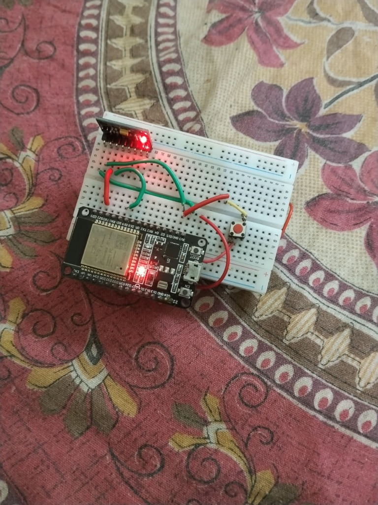
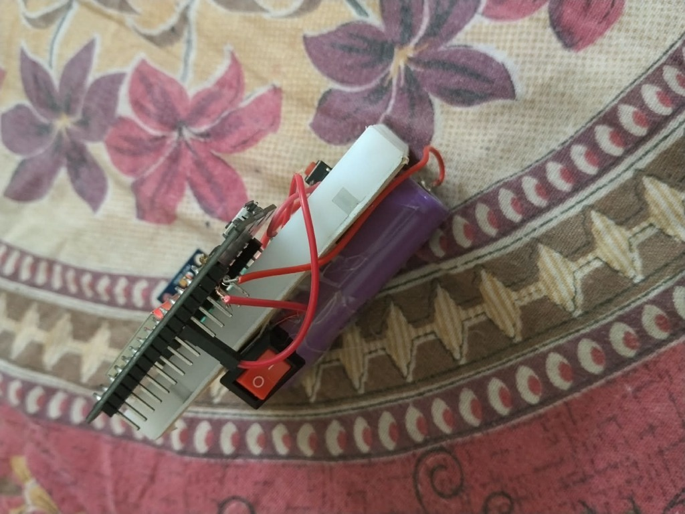
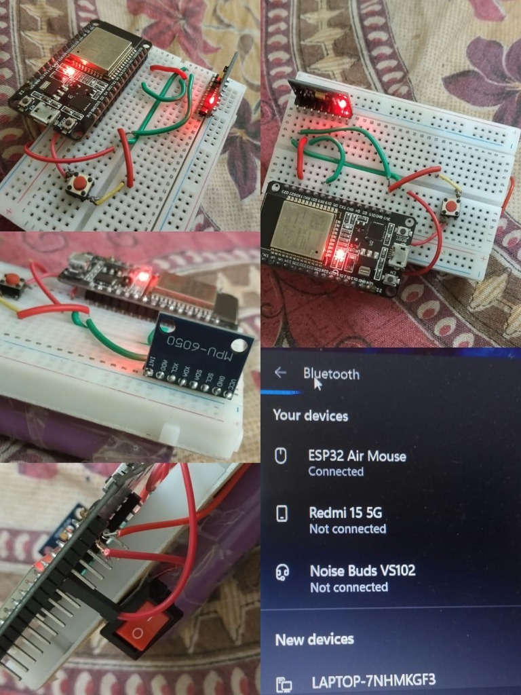
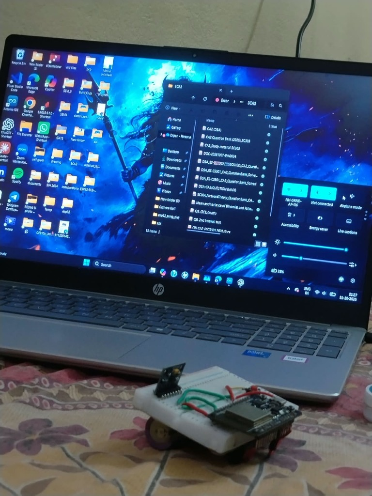

# 🖱️ ESP32 Air Mouse — Bluetooth Gyroscope Mouse

> **Control your PC cursor by moving your hand in the air!**  
> A wireless Bluetooth HID mouse built with ESP32 + MPU6050, powered by a Li-ion battery.

---

## 📸 Project Photos

| Front View | Battery Module |
|:-----------:|:--------------:|
|  |  |

| Build Progress & BT Connected | Live Demo with Laptop |
|:------------------------------:|:---------------------:|
|  |  |

> **Bluetooth Connected as:** `ESP32 Air Mouse` ✅

---

## 📋 Table of Contents

- [Overview](#-overview)
- [Features](#-features)
- [Hardware Required](#-hardware-required)
- [Circuit Connections](#-circuit-connections)
- [How It Works](#-how-it-works)
- [Software & Libraries](#-software--libraries)
- [Code](#-code)
- [Upload Instructions](#-upload-instructions)
- [Usage](#-usage)
- [Project Structure](#-project-structure)
- [Author](#-author)

---

## 🔍 Overview

The **ESP32 Air Mouse** is a gesture-controlled Bluetooth mouse.  
By tilting or rotating the device, the MPU6050 gyroscope/accelerometer reads the motion data and translates it into cursor movements on your PC — with **no USB cable, no optical sensor**, just your hand movement!

It connects to any Bluetooth-enabled device (Windows, Linux, Android) as a standard **HID (Human Interface Device)** mouse.

---

## ✨ Features

- 🖱️ **Wireless Bluetooth HID Mouse** — pairs like a normal mouse
- 🌀 **Gyroscope + Accelerometer** via MPU6050 over I2C
- 🔘 **Left Click** via push button on GPIO 27
- 🔋 **Battery-powered** — portable and cable-free
- ⚡ **Low power** ESP32-based design
- 📡 **Bluetooth Classic** (BT HID profile)

---

## 🛒 Hardware Required

| Component | Quantity |
|-----------|----------|
| ESP32 FM DevKit (38-pin) | 1 |
| MPU6050 Gyroscope + Accelerometer Module | 1 |
| Tactile Push Button | 1 |
| Li-ion 18650 Battery | 1 |
| TP4056 Battery Charger Module | 1 |
| Boost Converter (3.7V → 5V, optional) | 1 |
| Breadboard | 1 |
| Jumper Wires | Several |

---

## 🔌 Circuit Connections

### MPU6050 → ESP32

| MPU6050 Pin | ESP32 Pin |
|:-----------:|:---------:|
| VCC | 3.3V |
| GND | GND |
| SDA | GPIO 21 |
| SCL | GPIO 22 |
| INT | Not connected |

### Push Button → ESP32

| Push Button Terminal | ESP32 Pin |
|:--------------------:|:---------:|
| First terminal | GPIO 27 |
| Second terminal | GND |

> **Note:** The internal pull-up resistor on GPIO 27 is enabled in firmware — no external resistor needed.

---

## ⚙️ How It Works

```
[MPU6050] --I2C--> [ESP32] --Bluetooth HID--> [PC / Laptop]
                      |
               [Push Button] --> Left Click
```

1. The **MPU6050** reads raw accelerometer and gyroscope data over I2C.
2. The **ESP32** processes this data (applies complementary/Kalman filter) and maps tilt angles to X/Y mouse cursor movements.
3. The ESP32 advertises itself over **Bluetooth as an HID Mouse** (`ESP32 Air Mouse`).
4. Pressing the **push button** sends a **left click** HID report.
5. The whole device runs off a **Li-ion 18650 battery** charged via TP4056.

---

## 📦 Software & Libraries

Install these libraries in the **Arduino IDE** (or PlatformIO):

| Library | Purpose | Install via |
|---------|---------|-------------|
| `ESP32 BLE Arduino` | BLE / BT HID stack | Board package bundled |
| `Adafruit MPU6050` | MPU6050 driver | Arduino Library Manager |
| `Adafruit Unified Sensor` | Sensor abstraction | Arduino Library Manager |
| `Wire` | I2C communication | Built-in |

**Board:** `ESP32 Dev Module`  
**Arduino IDE:** 1.8.x or 2.x  
**ESP32 Board Package:** `esp32 by Espressif Systems` ≥ 2.0

---

## 💾 Code

The main firmware is in [`air_mouse.ino`](code/air_mouse.ino) (also provided as `air_mouse.txt` for quick viewing).

**Key code sections:**

```cpp
// I2C MPU6050 initialization
Wire.begin(21, 22);  // SDA=21, SCL=22
mpu.begin();

// Button with internal pull-up
pinMode(27, INPUT_PULLUP);

// Move mouse based on gyro tilt
mouse.move(gyroX_scaled, gyroY_scaled, 0);

// Left click on button press
if (digitalRead(27) == LOW) {
    mouse.click(MOUSE_LEFT);
}
```

---

## 🚀 Upload Instructions

1. **Install Arduino IDE** and add the ESP32 board package:
   - File → Preferences → Additional Board URLs:
     ```
     https://raw.githubusercontent.com/espressif/arduino-esp32/gh-pages/package_esp32_index.json
     ```
2. **Install libraries** listed above via *Sketch → Include Library → Manage Libraries*.
3. **Open** `code/air_mouse.ino` in Arduino IDE.
4. **Select Board:** `Tools → Board → ESP32 Dev Module`
5. **Select Port:** Choose the correct COM port.
6. **Upload** by clicking the ➡️ button.
7. After upload, open **Serial Monitor** at `115200 baud` to see debug output.

---

## 🕹️ Usage

1. Power on the device (turn on the battery switch).
2. On your PC go to **Settings → Bluetooth → Add Device**.
3. Select **`ESP32 Air Mouse`** from the list.
4. Once connected, **tilt the device** to move the cursor:
   - Tilt **left/right** → cursor moves **left/right**
   - Tilt **forward/backward** → cursor moves **up/down**
5. Press the **push button** → **Left Click**

---

## 📁 Project Structure

```
esp32-air-mouse/
│
├── code/
│   ├── air_mouse.ino       # Arduino sketch (main firmware)
│   └── air_mouse.txt       # Same code in plain text (for quick view)
│
├── photos/
│   ├── air_mouse_front.jpg
│   ├── battery_module.jpg
│   ├── build_and_bluetooth.jpg
│   └── live_demo.jpg
│
├── videos/
│   └── demo.mp4            # Working demo video
│
└── README.md
```

---

## 🧑‍💻 Author

**Dipan Roy**  
Btech Student | Hardware Enthusiast | Arduino & ESP32 Developer

- 📧 Feel free to open an **Issue** or **Pull Request** for improvements!
- ⭐ If you found this project useful, please **star** the repo!

---

## 📜 License

This project is open-source under the **MIT License**.  
Feel free to use, modify, and share!

---

> *"Turning hand gestures into mouse movements — no wires, just vibes!"* 🚀
